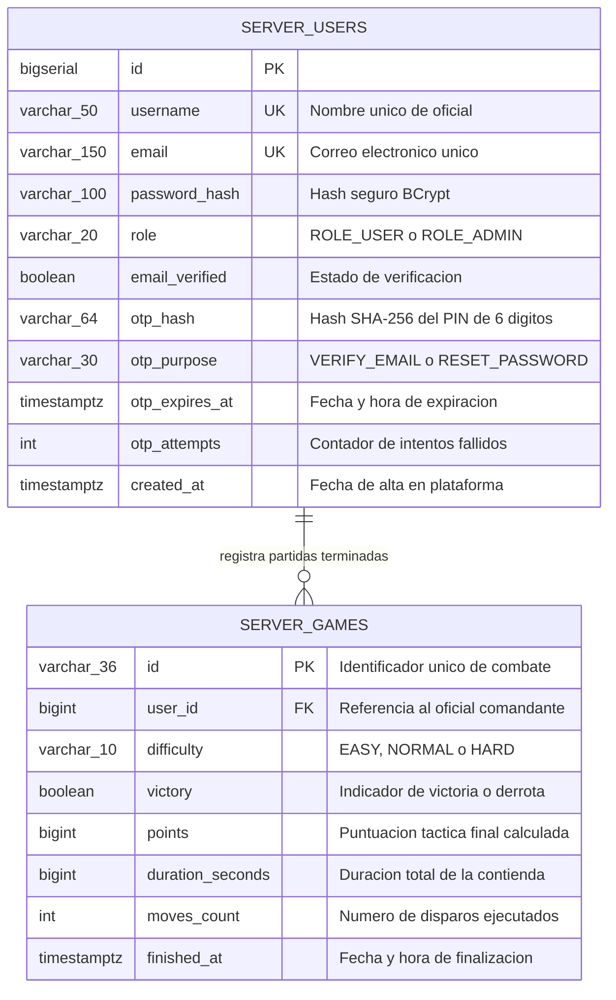

# FleetGrid Platform - Manual Maestro de Ingenieria y Hoja de Ruta del Agente

> [!NOTE]
> **Trazabilidad y Origen Academico:** FleetGrid es la evolucion tecnologica y maduracion profesional del proyecto de software universitario original `Battleship_IWSIM21-07` (UPM - ETSISI).

Este documento constituye la fuente unica de verdad tecnica, arquitectonica y operativa de la plataforma FleetGrid. Todo agente o desarrollador debe adherirse estrictamente a estas especificaciones sin desviacion alguna.

---

## 1. Arquitectura del Sistema, Stack Tecnologico y Versiones

FleetGrid esta disenado bajo los principios de Clean Architecture y desacoplamiento total en tres modulos principales:

```mermaid
flowchart TD
    subgraph Client["Cliente Web"]
        UI["Next.js 16 (App Router / Turbopack)\nReact 19, TypeScript 5, Tailwind v4"]
        Warm["WarmUp Component (Lazy Health Ping)"]
        Metrics["WebMetrics Component (Isolated)"]
    end

    subgraph Edge["Red y Edge CDN"]
        VercelEdge["Vercel Edge Network (fleetgrid.me)"]
        Uptime["UptimeRobot Monitor (5 min keep-alive)"]
    end

    subgraph BackendApp["Servidor de Aplicacion (Render Frankfurt)"]
        FilterRate["Bucket4j RateLimitingFilter (Memory)"]
        SecFilter["JwtAuthenticationFilter (Stateless JWT)"]
        CacheAuth["Caffeine Auth Cache (Short TTL)"]
        CacheRank["Caffeine Leaderboard Cache"]
        SpringApp["Spring Boot 3.2.5 REST API"]
        Hikari["HikariCP Pool (minIdle=0, max=4)"]
    end

    subgraph Persistence["Capa de Persistencia Serverless (Neon Frankfurt)"]
        Postgres["PostgreSQL 16 Serverless\nTablas: server_users, server_games\nAutosuspend tras 5 min"]
    end

    subgraph External["Servicios Externos Transaccionales"]
        Brevo["Brevo API v3 (HTTPS / Puerto 443)\nTransmision OTP"]
    end

    UI --> VercelEdge
    VercelEdge --> BackendApp
    Uptime -.->|Ping /healthz (No DB)| BackendApp
    Warm -.->|Ping /healthz (No DB)| BackendApp
    BackendApp --> FilterRate
    FilterRate --> SecFilter
    SecFilter --> CacheAuth
    SpringApp --> CacheRank
    SpringApp --> Hikari
    Hikari -->|Solo acciones reales| Postgres
    SpringApp -->|Envio de correo| Brevo
```

### Componentes y Versiones Oficiales del Stack

1. **battleship-core (`core/`):**
   * Java 17 / 22.
   * Dominio puro agnostico a frameworks: entidades de tablero (`Board`), celdas (`Cell`), navios (`Carrier`, `Battleship`, `Submarine`, `PatrolBoat`) y niebla de guerra.
   * Motor de IA con tres algoritmos: `BasicAlgorithm` (aleatorio puro), `NormalAlgorithm` (Hunt & Target) y `ExpertAlgorithm` (campo probabilistico de calor refinado x50).
2. **battleship-backend (`backend/`):**
   * Java 17, Spring Boot 3.2.5.
   * Spring Security 6 stateless con JWT (`jjwt` 0.12.5) y cookies seguras (`httpOnly`, `Secure`, `SameSite=Lax`).
   * Spring Data JPA sobre PostgreSQL 16 con migraciones automatizadas mediante Flyway (`ddl-auto: validate`).
   * SpringDoc OpenAPI 2.5.0 / Swagger UI 5.13.0.
   * Control de tasa en memoria con Bucket4j y politicas defensivas anti-DoS.
   * Capa de cache local en memoria con Caffeine para clasificaciones y verificacion de credenciales sin golpear la base de datos.
3. **frontend (`frontend/`):**
   * Next.js 16.4.3 (App Router, Turbopack, compilacion `standalone`, `cacheComponents`).
   * React 19.3.0, TypeScript 5.
   * Tailwind CSS v4, Lucide React, Sonner (notificaciones toast), Canvas Confetti.
   * Sintetizador de audio nativo mediante Web Audio API (cero dependencias de audio externas).

---

## 2. Politica Estricta de Idiomas

FleetGrid aplica una separacion linguistica rigurosa y no negociable:

| Ambito | Idioma Requerido | Ejemplos Validos | Ejemplos Prohibidos |
|---|---|---|---|
| **Codigo Fuente** (clases, metodos, atributos, variables, paquetes, carpetas) | **Ingles (100%)** | `public void fireShot(int row, int col)`, `GameSessionMetadata`, `userRepository` | `public void disparar()`, `SesionJuego`, `usuarioRepo` |
| **Salidas de Ejecucion** (logs, consola, nombres de excepciones, mensajes HTTP de API) | **Ingles (100%)** | `logger.info("Shot processed at ({}, {})", r, c)`, `throw new ResourceNotFoundException("Game not found")` | `logger.info("Disparo procesado")`, `"Partida no encontrada"` |
| **Textos Visibles al Usuario** (UI web, titulos, botones, modales, plantillas de correo, errores de API en cliente) | **Ingles (100%)** | `"SIGN IN"`, `"DECISIVE NAVAL VICTORY"`, `"Verification PIN: 123456"`, `"If you did not request this, ignore this email"` | `"INICIAR SESION"`, `"VICTORIA NAVAL"`, `"Tu codigo es"` |
| **Documentacion y Especificaciones** (Markdown, README, AGENTS.md, especificaciones de arquitectura) | **Espanol Tecnico (100%)** | "Arquitectura desacoplada en tres capas con patron Hexagonal", "Presupuesto de actividad de base de datos" | "Decoupled architecture in three layers", spanglish o tildes omitidas |
| **Comentarios de Codigo y Bloques JavaDoc / TSDoc** | **Espanol Tecnico (100%)** | `/** Procesa el impacto tactico en las coordenadas dadas. */` | `/** Processes tactical impact at coordinates. */` |

> [!IMPORTANT]
> **Revision Obligatoria de Todo el Repositorio:** En cada hito y antes de cerrar cualquier tarea, se debe auditar exhaustivamente todo el repositorio (codigo Java, TypeScript, tests, archivos YAML, anotaciones Swagger, plantillas de correo, logs y Markdown) para garantizar que ninguna palabra fuera de politica contamine el proyecto.

---

## 3. Normas de Documentacion Tecnica

1. **Tolerancia Cero a Emojis:** Queda terminantemente prohibido el uso de emojis en cualquier archivo de documentacion tecnica, diagramas, comentarios de codigo o mensajes de commit.
2. **Diagramas Formales Mermaid:** Toda interaccion de arquitectura, flujo de datos o modelo de entidades debe modelarse mediante diagramas Mermaid modernos (`flowchart`, `sequenceDiagram`, `classDiagram`, `erDiagram`).
3. **Especificacion Interactiva OpenAPI:** Todo endpoint REST debe estar documentado formalmente con anotaciones SpringDoc OpenAPI en ingles y expuesto en `/swagger-ui.html`.

---

## 4. Definition of Done (DoD) - Lista Ejecutable

Para declarar cualquier hito o tarea como completada, se debe ejecutar y verificar sin errores la siguiente lista de comandos:

```bash
# 1. Compilacion y suite de pruebas del motor de dominio y backend
./mvnw clean test -B

# 2. Verificacion de tipos estaticos y compilacion del frontend Next.js
cd frontend && npx tsc --noEmit && npm run build

# 3. Linter de frontend
cd frontend && npm run lint

# 4. Suite de pruebas unitarias y de componentes del frontend
cd frontend && npm run test

# 5. Pruebas End-to-End con Playwright
cd frontend && npx playwright test

# 6. Auditoria de ciberseguridad y dependencias
./mvnw org.owasp:dependency-check-maven:check -DfailBuildOnCVSS=7
cd frontend && npm audit --audit-level=high

# 7. Escaneo estricto de secretos en el historial de Git
gitleaks detect --source . -v

# 8. Verificacion de politicas linguisticas y ortografia
# (Comprueba ausencia de literales espanoles en codigo Java/TS y tildes en documentacion)
./mvnw test -Dtest=LanguagePolicyRegressionTest
```

---

## 5. Restricciones Operativas de Infraestructura y Presupuesto de Cursos Gratuitos

FleetGrid opera bajo una arquitectura cloud con planes gratuitos estrictos. Cada recurso debe optimizarse al maximo para garantizar estabilidad continua sin costes:

### Restricciones de Render (Backend REST API)
* **Cuota Mensual:** 750 horas de computo gratuitas por mes y por workspace.
* **Calculo de Operacion 24/7:** Un unico servicio web activo 24/7 consume exactamente 720 horas (mes de 30 dias) o 744 horas (mes de 31 dias).
* **Regla Operativa Obligatoria:** Este workspace de Render **NO PUEDE TENER NINGUN OTRO SERVICIO GRATUITO**.
* **Prohibicion de Entornos Efimeros:** Quedan totalmente desactivados los entornos de Pull Request (Previews) en Render.
* **Arranque en Frio:** El arranque en frio tras un reinicio de Render puede demorarse hasta 60 segundos.
* **Plan de Contingencia de Horas:** Si a mitad de mes el consumo de horas de Render supera el umbral de seguridad (por ejemplo, mas de 380 horas consumidas el dia 15), se debe desactivar temporalmente el monitor keep-alive de UptimeRobot y confiar exclusivamente en el despertar por demanda ejecutado por el componente `WarmUp` del frontend.

### Restricciones de Neon (PostgreSQL 16 Serverless)
* **Cuota Mensual:** 100 Compute Unit-hours (CU-hours) por mes por proyecto, y 0.5 GB de almacenamiento.
* **Suspension Automatica:** Neon suspende el computo automaticamente tras 5 minutos continuos de inactividad de conexiones.
* **Riesgo Critico de Agotamiento:** Una base de datos mantenida despierta 24/7 consume 1 CU de forma constante, lo que agotaria la cuota mensual de 100 CU-hours en aproximadamente **17 dias**, provocando la suspension forzada y la caida del servicio.
* **REGLA DE ORO DE INFRAESTRUCTURA: LA BASE DE DATOS DEBE PODER DORMIR.**

### Politica y Presupuesto de Actividad de Base de Datos
1. **Solo Acciones Reales de Usuario Consultan la BD:** Ningun proceso automatico (rastreadores, bots, pings de monitorizacion, health checks, tareas programadas de background ni precarga de caches) puede consultar la base de datos.
2. **/healthz Aislado y Estatico:** El endpoint `/healthz` responde con codigo HTTP 200, texto minimo estatico, cabecera `Cache-Control: no-store`, sin inyectar `DataSource`, sin invocar repositorios y sin emitir logs a nivel `INFO` por cada peticion.
3. **Pool HikariCP Ultraligero:**
   * `maximumPoolSize`: 3 a 5 conexiones.
   * `minimumIdle`: 0 (permite al pool liberar todas las conexiones inactivas).
   * `idleTimeout`: 30 000 ms (30 segundos).
   * `keepaliveTime`: 0 (desactivado: un ping keepalive mantendria la base de datos despierta permanentemente).
   * `connectionTimeout`: 15 000 ms (15 segundos, tolerancia suficiente para el arranque en frio de Neon sin fallar a los usuarios).
4. **Autenticacion Stateless sin Lectura de BD por Peticion:** El filtro `JwtAuthenticationFilter` extrae el usuario y rol directamente desde los claims firmados del JWT. Para validar revocaciones o cambios de contrasena, consulta una cache local Caffeine con TTL de 5 minutos; la base de datos solo se consulta en caso de fallo de cache.
5. **Rate Limiting Previo a Persistencia:** Todo control de tasa (Bucket4j) intercepta y descarta peticiones abusivas (429 Too Many Requests) en memoria antes de que alcancen cualquier repositorio de base de datos.
6. **Partidas en Memoria:** Las partidas en curso residen exclusivamente en memoria (`activeSessions`). Si una partida es abandonada, puntua 0 y no escribe absolutamente ninguna fila en la base de datos.

---

## 6. Esquema de Base de Datos Final (Dos Tablas) y Politica de Datos

La persistencia relacional en PostgreSQL se reduce estrictamente a dos tablas fundamentales:



### Reglas de Depuracion y Tablas Eliminadas
* **Eliminacion de `server_moves`:** Cada disparo ya no se persiste en base de datos. Los movimientos se gestionan en la sesion en memoria y se descartan tras el combate.
* **Eliminacion de `server_leaderboard`:** La duplicidad de registros queda eliminada; los rankings se calculan en tiempo real mediante consultas optimizadas sobre `server_games` unida a `server_users`.
* **Indices Estrategicos:**
  * `idx_games_points_desc`: optimiza el Top 10 de mejores partidas globales (`points DESC`).
  * `idx_games_user_points`: optimiza el expediente militar y top personal (`user_id, points DESC`).
  * `idx_games_user_finished`: optimiza las ultimas 10 partidas cronologicas (`user_id, finished_at DESC`).
* **Politica de Retencion:** Cuentas de oficiales (`server_users`) permanecen de forma indefinida. Partidas finalizadas (`server_games`) se conservan de forma permanente para el historico de honor. Las sesiones en memoria incompletas expiran tras 1 hora de inactividad.

---

## 7. Ciberseguridad Defensiva y Blindaje de la Plataforma

1. **Gestion de Secretos:** Prohibicion absoluta de claves o secretos por defecto en entornos productivos. El backend abortara el arranque si `JWT_SECRET` no esta configurado o mide menos de 32 bytes en el perfil `prod`.
2. **Proteccion de Credenciales:** Las contrasenas jamas se envian por correo electronico ni se registran en logs. Se almacenan exclusivamente con algoritmo BCrypt (factor de coste 10). La longitud de contrasena esta acotada a un maximo de 50 caracteres para prevenir ataques de denegacion de servicio algoritmico (DoS por BCrypt).
3. **Manejo Seguro de OTP:** Los codigos PIN de 6 digitos nunca se almacenan en texto plano en la base de datos; se almacena su hash criptografico y se verifican en tiempo constante (`MessageDigest.isEqual`) con un maximo de 5 intentos y expiracion a los 10 minutos.
4. **Prevencion de Enumeracion de Usuarios:** Los endpoints de registro, verificacion, reenvio de codigo y recuperacion de contrasena responden con mensajes genericos y tiempos de respuesta homogeneos, impidiendo discernir si una cuenta existe o no.
5. **Cabeceras de Seguridad HTTP:**
   * Content Security Policy (CSP) estricta: `default-src 'self'; script-src 'self' 'unsafe-inline' https://cdn.jsdelivr.net; style-src 'self' 'unsafe-inline'; img-src 'self' data: https:; font-src 'self' data:; connect-src 'self' https://api.fleetgrid.me; frame-ancestors 'none';`.
   * Strict-Transport-Security (HSTS): `max-age=31536000; includeSubDomains; preload`.
   * `X-Content-Type-Options: nosniff`.
   * `X-Frame-Options: DENY`.
   * `Referrer-Policy: strict-origin-when-cross-origin`.
   * `Permissions-Policy: camera=(), microphone=(), geolocation=()`.
6. **Manejo Seguro de JWT:** Las sesiones en produccion operan mediante cookies con atributos `HttpOnly`, `Secure`, `SameSite=Lax` y proteccion contra ataques CSRF mediante cabeceras personalizadas de solicitud.

---

## 8. Presupuesto de Rendimiento y Latencias Objetivo

| Operacion | Latencia Objetivo (p95) | Acceso a Base de Datos | Consumo de Red |
|---|---|---|---|
| Disparo Tactico (`POST /games/{id}/shots`) | < 80 ms | 0 consultas (partida en curso) | 1 peticion HTTP unica con telemetria y estado completo |
| Fin de Partida (Ultimo impacto) | < 120 ms | 1 insercion (`server_games`) | Telemetria final y calculo de puntos |
| Ping de Monitorizacion (`GET /healthz`) | < 10 ms | 0 consultas (memoria pura) | < 50 bytes |
| Consulta de Rankings (`GET /leaderboard/*`) | < 30 ms (con cache) | 0 consultas (hit en cache Caffeine) | Respuesta JSON optimizada |
| Memoria RAM en Reposo (Backend Docker) | <= 280 MB | - | Margen seguro dentro de 512 MB de Render |

### Instrucciones de Ejecucion de Pruebas de Carga con k6

El script de prueba de carga se ubica en `load-tests/combat-load-test.js` y simula a 20 comandantes concurrentes ejecutando combates navales completos con cadencia reglamentaria de 2 segundos entre salvas:

1. **Instalacion de k6:** Instalar mediante `winget install k6` (Windows), `brew install k6` (macOS) o mediante binario oficial desde [k6.io](https://k6.io/).
2. **Ejecucion local contra el backend:**
   ```bash
   k6 run load-tests/combat-load-test.js
   ```
3. **Ejecucion parametrizada contra produccion o staging:**
   ```bash
   k6 run -e TARGET_URL=https://api.fleetgrid.me/api/v1 load-tests/combat-load-test.js
   ```
4. **Criterios estrictos de aprobacion (Thresholds):**
   - `http_req_duration`: Percentil 95 (`p(95)`) inferior a 200 ms.
   - `http_req_failed`: Tasa de error inferior al 1% (`rate < 0.01`).
   - `combat_success_rate`: Partidas resueltas satisfactoriamente superior al 99%.

---

## 9. Despliegue Git y Control de Commits

> [!CAUTION]
> **Prohibicion Expresa de Git Push Automatizado:** Queda terminantemente prohibido que el asistente AI ejecute comandos `git push` o interactue con ramas remotas. Todo push y despliegue a produccion es responsabilidad manual y soberana del desarrollador.

* La labor del agente se limita a:
  1. Preparacion de cambios en el arbol de trabajo (`git add`).
  2. Creacion de commits semanticos locales con mensajes descriptivos.
  3. Verificacion de estado limpio (`git status`).
  4. Entrega de las instrucciones de subida en texto plano al usuario.

---

## 10. Politica y Registro de Skills de Agente

El directorio `.agents/skills` contiene las capacidades operativas del entorno de desarrollo. Toda nueva habilidad instalada debe auditarse e inscribirse formalmente en `skills-lock.json` con su estructura estandar:

```json
"nombre-skill": {
  "source": "repositorio/origen",
  "sourceType": "github",
  "skillPath": "skills/nombre-skill/SKILL.md",
  "computedHash": "hash-sha256-del-contenido"
}
```

### Catalogo de Skills Principales y Casos de Uso
* `webapp-testing`: Verificacion funcional y pruebas locales con Playwright.
* `design-taste-frontend` y `emil-design-eng`: Direccion artistica y pulido de interfaces visuales.
* `vercel-react-best-practices`: Optimizacion de patrones en Next.js y React 19.
* `seo`: Auditoria y aplicacion de mejoras SEO tecnicas y metadatos.

---

## 11. Portabilidad, Configuracion de Proveedores y Servicios Cloud

FleetGrid preserva total independencia de proveedores de nube e infraestructura mediante capas de abstraccion nativas y una arquitectura modular serverless.

### 11.1 Resumen Operativo de Configuracion por Plataforma Web

A continuacion se detallan formalmente todas las configuraciones manuales y aprovisionamientos realizados en cada consola web:

* **Namecheap (Registrador de Dominio y DNS Avanzado):**
  - **Dominio registrado:** `fleetgrid.me` (activado mediante GitHub Student Developer Pack con vigencia hasta 2027).
  - **Registros DNS en Host Records (Advanced DNS):**
    - Registro **A**: Host `@` apuntando a `76.76.21.21` (Direccion IP Anycast de Vercel para el dominio apex canonico).
    - Registro **CNAME**: Host `www` apuntando a `cname.vercel-dns.com.` (Redireccion HTTP 301 automatica de `www.fleetgrid.me` a `fleetgrid.me`).
    - Registro **CNAME**: Host `api` apuntando a `battleship-backend-ys61.onrender.com.` (Enrutamiento del subdominio de la API hacia el Web Service de Render).
    - Registro **CNAME (DKIM 1)**: Host `brevo1._domainkey` apuntando a `b1.fleetgrid-me.dkim.brevo.com.` (Firma digital de correo).
    - Registro **CNAME (DKIM 2)**: Host `brevo2._domainkey` apuntando a `b2.fleetgrid-me.dkim.brevo.com.` (Firma digital de correo).
    - Registro **TXT**: Host `@` con valor `google-site-verification=...` (Verificacion de propiedad de dominio en Google Search Console).
  - **Mail Settings (Email Forwarding):** Redireccion de cortesia configurada desde `hello@fleetgrid.me` (Reply-To oficial) hacia el buzon de correo personal del desarrollador.

* **Vercel (Hosting del Frontend Web y Edge CDN):**
  - **Proyecto:** `fleetgrid` enlazado al repositorio GitHub (rama `main`).
  - **Dominios configurados en Vercel:**
    - `fleetgrid.me`: Dominio de produccion canonico.
    - `www.fleetgrid.me`: Configurado con redireccion 301 automatica permanente hacia `fleetgrid.me`.
  - **Variables de Entorno (Project Settings > Environment Variables):** Guardadas obligatoriamente bajo el tipo **Config** (no Secret, requerido por Vercel para variables con prefijo `NEXT_PUBLIC_` expuestas al cliente web).

* **Render (Hosting del Servidor Backend REST API):**
  - **Servicio:** Web Service `battleship-backend` (Frankfurt, plan gratuito, un unico servicio activo para respetar el presupuesto de 750 h/mes).
  - **Custom Domains:** Subdominio `api.fleetgrid.me` registrado y verificado en la seccion **Settings > Custom Domains**, con certificado TLS/SSL aprovisionado de forma automatica por Render.
  - **Variables de Entorno (Environment):** Variables de produccion del backend (`SPRING_PROFILES_ACTIVE`, `SPRING_DATASOURCE_URL`, `JWT_SECRET`, `BREVO_API_KEY`, etc.).

* **Neon (Capa de Persistencia PostgreSQL 16 Serverless):**
  - **Instancia:** Compute serverless en Frankfurt (`ep-silent-waterfall...aws.neon.tech`).
  - **Politica de Suspension:** Modo autosuspend a los 5 minutos de inactividad de conexiones para garantizar consumo cero de computo cuando no hay partidas en curso (presupuesto estricto de 100 CU-h/mes).
  - **Seguridad:** Conexiones cifradas obligatorias via SSL (`sslmode=require`).

* **Brevo (Servicio Transaccional de Correo Electronico):**
  - **Dominio autenticado:** `fleetgrid.me` verificado con firmas criptograficas DKIM vinculadas desde Namecheap.
  - **Remitente autorizado:** `noreply@fleetgrid.me` ("FleetGrid Command"), con Reply-To `hello@fleetgrid.me`.
  - **Credenciales API:** Clave de API v3 generada en la seccion **SMTP y API** para despacho seguro por HTTPS en puerto 443 (sin bloqueo de puertos SMTP).
  - **Subdominio con marca:** Omitido (no requerido para correo transaccional de autenticacion).

* **Google Search Console y Bing Webmaster Tools (SEO e Indexacion):**
  - **Google Search Console:** Verificacion de propiedad completada por registro DNS TXT. Sitemap enviado y verificado con exito en `sitemap.xml` con las 5 URLs canonicas descubiertas (`/`, `/leaderboard`, `/rules`, `/faq`, `/privacy`).
  - **Bing Webmaster Tools:** Importacion directa de sitemaps y verificacion de propiedad sincronizada desde Google Search Console en un solo paso.

* **UptimeRobot (Monitor Keep-Alive de Disponibilidad):**
  - **Monitor:** HTTP(s) cada 5 minutos apuntando al endpoint estatico `https://api.fleetgrid.me/healthz`.
  - **Aislamiento de BD:** `/healthz` responde en memoria pura sin tocar la base de datos ni el pool HikariCP, manteniendo a Render activo 24/7 mientras Neon se suspende tras 5 minutos sin actividad de usuarios reales.

---

### 11.2 Matriz de Portabilidad y Alternativas

| Proveedor Actual | Rol en la Plataforma | Abstraccion Propia | Procedimiento de Migracion a Alternativa |
|---|---|---|---|
| **Vercel** | Hosting de Frontend y Edge CDN | Next.js Standalone Docker (`frontend/Dockerfile`) | Desplegar el contenedor Docker en Cloudflare Pages, AWS Amplify, Render o VPS con Nginx. |
| **Render** | Servidor de Backend REST API | Dockerfile multi-stage estandar (`backend/Dockerfile`) | Mover el contenedor a Railway, Fly.io, AWS App Runner o Hetzner Cloud sin alterar una linea de codigo. |
| **Neon** | Base de datos PostgreSQL serverless | Spring Data JPA / JDBC estandar | Ejecutar `pg_dump` y restaurar en Supabase, AWS RDS, Tembo o PostgreSQL local. |
| **Brevo** | Despacho transaccional de correo OTP | Puerto `EmailSender` (`BrevoEmailSender`, `SmtpEmailSender`) | Configurar `mail.provider=smtp` para utilizar AWS SES, SendGrid, Mailgun o cualquier servidor SMTP estandar. |
| **UptimeRobot** | Monitor keep-alive HTTP | Endpoint generico `/healthz` | Configurar BetterStack, Cron-Job.org o Pingdom hacia `https://api.fleetgrid.me/healthz`. |
| **Namecheap** | Registrador de Dominio y DNS | Registros estandar DNS (A, CNAME, TXT) | Cambiar los servidores de nombres (Nameservers) hacia Cloudflare DNS, Route53 o Porkbun. |
| **Vercel Metrics** | Telemetria y rendimiento web | Componente `WebMetrics.tsx` aislado | Reemplazar los componentes de Vercel por Cloudflare Web Analytics o instancia autoalojada de Umami. |

> [!TIP]
> **Sustitucion de Vercel Metrics en < 10 lineas:** En `frontend/src/components/WebMetrics.tsx`, reemplaza el retorno del componente por el script de tu proveedor:
> - **Umami:** `<Script async src="https://tu-umami.com/script.js" data-website-id="TU_WEBSITE_ID" />`
> - **Cloudflare:** `<Script defer src="https://static.cloudflareinsights.com/beacon.min.js" data-cf-beacon='{"token": "TU_TOKEN"}' />`
> No se requiere alterar ningun otro componente, layout ni ruta de la plataforma.

---

## 12. Catalogo Maestro de Variables de Entorno

| Variable | Modulo | Plataforma / Panel de Configuracion | Descripcion | Obligatoria en Prod | Valor Predeterminado Local / Ejemplo |
|---|---|---|---|---|---|
| `PORT` | Backend | Render (Variable interna del sistema) | Puerto HTTP de escucha asignado por el orquestador | Si (automatica) | `8080` (en local) |
| `SPRING_PROFILES_ACTIVE` | Backend | Render (`Environment`) | Perfil activo de Spring Boot (`prod` o `dev`) | Si | `dev` |
| `SPRING_DATASOURCE_URL` | Backend | Render (`Environment`) | Cadena de conexion PostgreSQL (Neon Frankfurt con SSL) | Si | `jdbc:h2:mem:battleship_db;...` |
| `SPRING_DATASOURCE_USERNAME` | Backend | Render (`Environment`) | Usuario de BD *(opcional si esta contenido en la URL)* | No (autoextraido) | `sa` |
| `SPRING_DATASOURCE_PASSWORD` | Backend | Render (`Environment`) | Contrasena de BD *(opcional si esta contenida en la URL)* | No (autoextraido) | *(vacio)* |
| `JWT_SECRET` | Backend | Render (`Environment`) | Clave criptografica HMAC-SHA256 (minimo 256 bits) | Si | Clave dev de prueba |
| `BREVO_API_KEY` | Backend | Render (`Environment`) | Clave de API v3 de Brevo para envio transaccional OTP | Si | *(vacio, activa mock local)* |
| `BREVO_SENDER_EMAIL` | Backend | Render (`Environment`) | Remitente oficial de correos autorizados | Si | `noreply@fleetgrid.me` |
| `MAIL_PROVIDER` | Backend | Render (`Environment`) | Proveedor de correo (`brevo`, `smtp`, `mock`) | No | `mock` en dev, `brevo` en prod |
| `CORS_ALLOWED_ORIGINS` | Backend | Render (`Environment`) | Origenes autorizados para intercambio de recursos CORS | Si | `http://localhost:3000` |
| `NEXT_PUBLIC_API_URL` | Frontend | Vercel (`Environment Variables`, tipo `Config`) | URL base publica de la API REST para el cliente web | Si | `http://localhost:8080/api/v1` |
| `NEXT_PUBLIC_ENABLE_VERCEL_METRICS` | Frontend | Vercel (`Environment Variables`, tipo `Config`) | Habilita analiticas y telemetria Web Vitals en Vercel | No | `false` |

---

## 13. Estado del Master Roadmap

- [x] **Hito 1:** Motor de Dominio Puro (`battleship-core`) con Clean Architecture y algoritmos de IA.
- [x] **Hito 2:** Backend Enterprise Spring Boot 3 con JWT, JPA y OpenAPI.
- [x] **Hito 3:** Frontend Tactico Next.js 16 con estetica militar CRT y Web Audio API.
- [x] **Hito 4:** Infraestructura DevOps, Docker multi-stage y despliegue cloud inicial.
- [x] **Hito 5 (Completado):** Gamificacion tactica, doble ranking en Admiralty Roll, modo invitado con reclamacion, verificacion OTP, expediente de oficial, optimizacion extrema de consumo de base de datos (dos tablas), un solo viaje de red por disparo, SEO tecnico integral y suite de pruebas automatizada.
- [ ] **Hito 6 (Fuera de Alcance / Aplazado):** Multijugador en tiempo real con WebSockets (STOMP/SockJS). Esta funcionalidad queda formalmente aplazada para fases futuras.

> [!IMPORTANT]
> **Cifras de Pruebas:** Queda prohibido hardcodear cantidades estaticas de tests en la documentacion. Los resultados reales deben consultarse en el reporte generado de ejecucion en [pruebas/PLAN_Y_REPORTE_DE_PRUEBAS.md](pruebas/PLAN_Y_REPORTE_DE_PRUEBAS.md).
