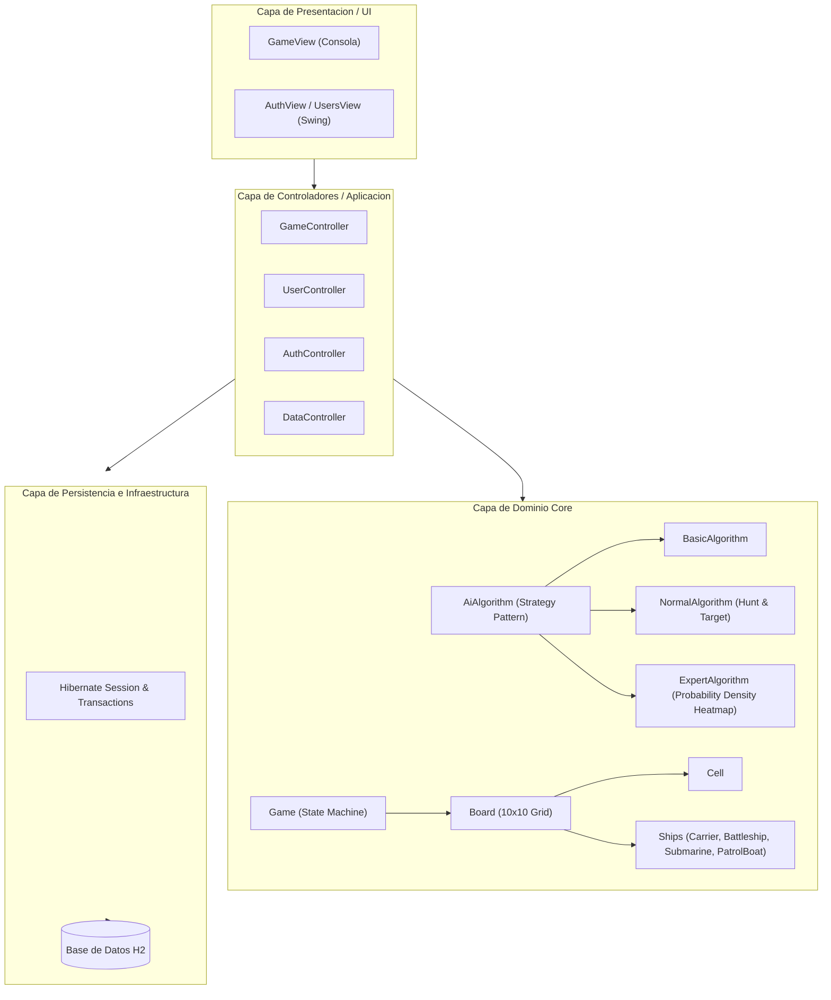
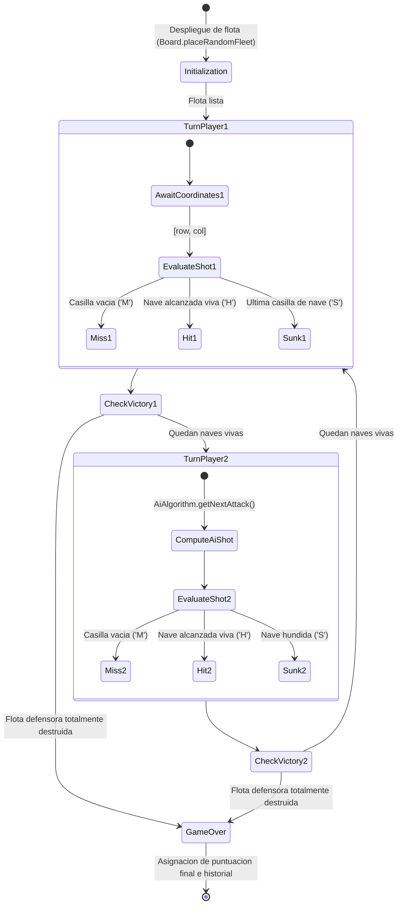

# Arquitectura y Diseño Tecnico - Battleship Platform

Este documento actualiza y consolida las especificaciones tecnicas de arquitectura, modelado del dominio y patrones de diseno aplicados en la plataforma, sustituyendo los diagramas estaticos previos mediante especificaciones en formato Mermaid.

---

## 1. Diagrama de Componentes (Clean Architecture)

El sistema estructura sus responsabilidades siguiendo principios de Clean Architecture y separacion de incumbencias.

---

## 2. Diagrama de Clases del Dominio

Representacion de la jerarquia de naves, participantes y contratos del dominio.

---

## 3. Maquina de Estados de Partida e Impactos

---

## 4. Estrategias Algoritmicas de Inteligencia Artificial

