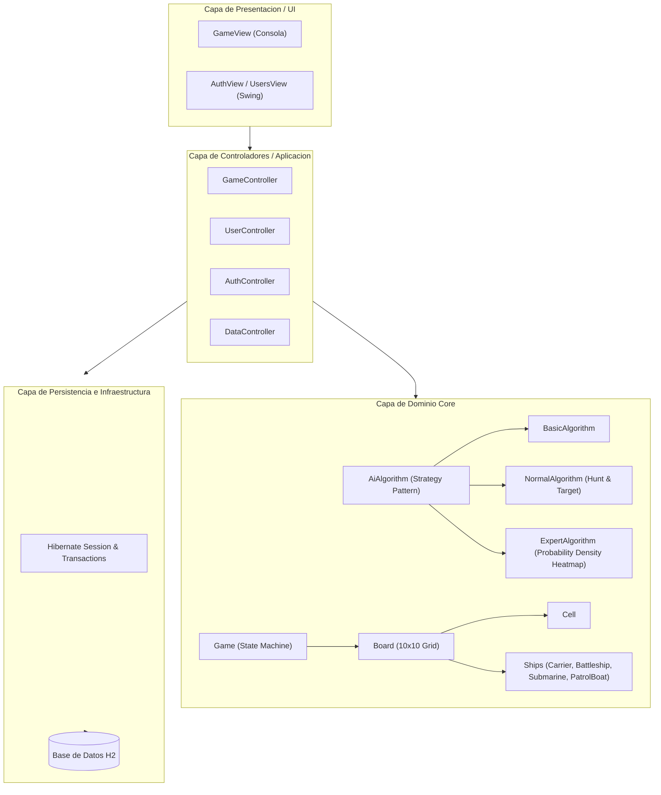
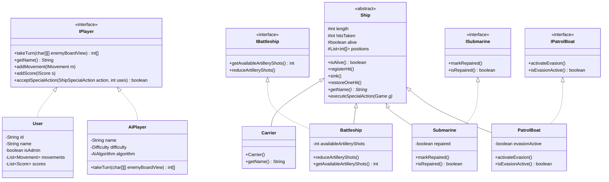
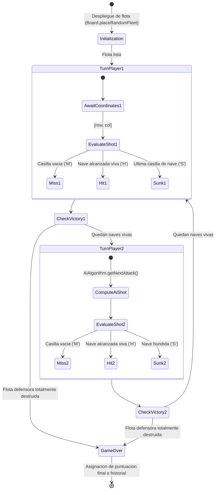
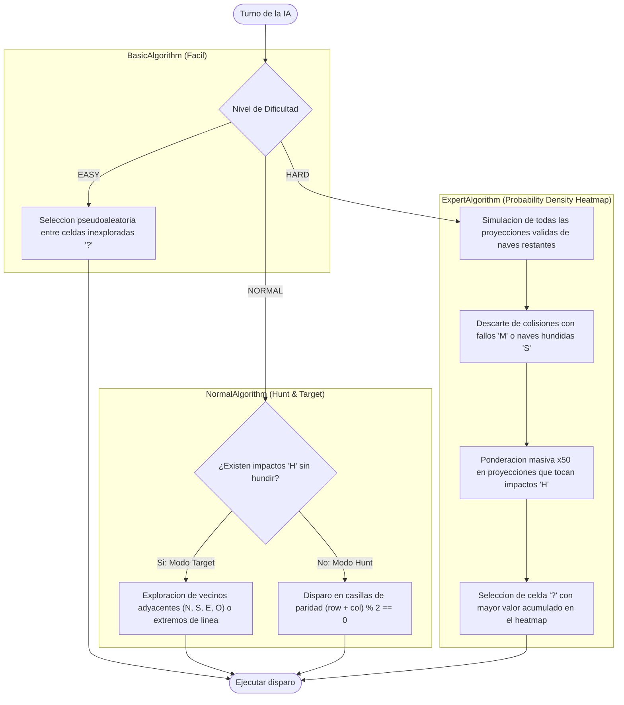
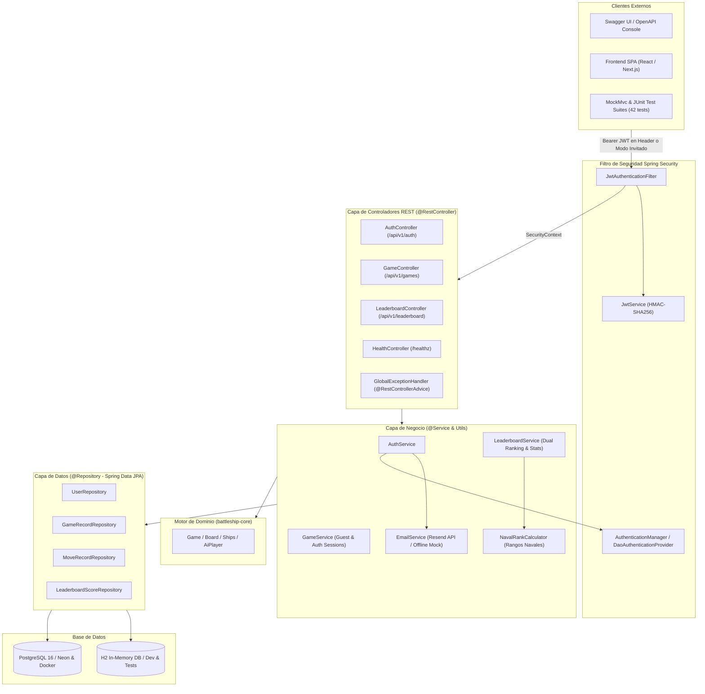
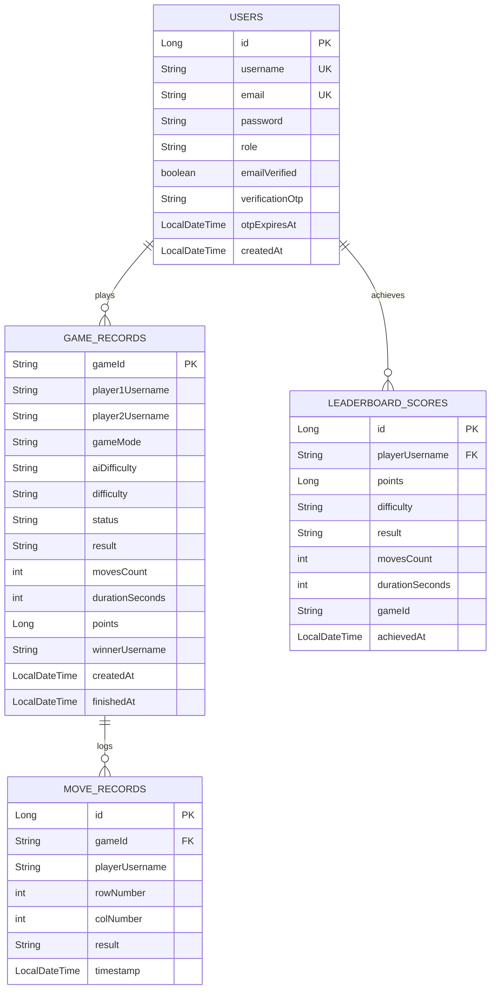
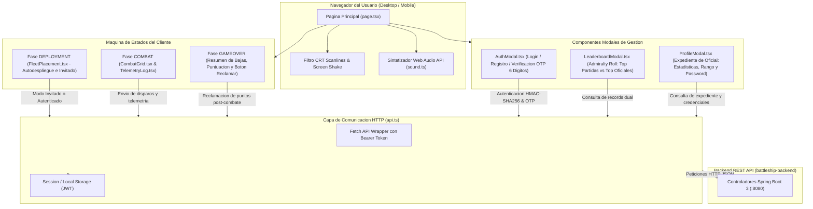
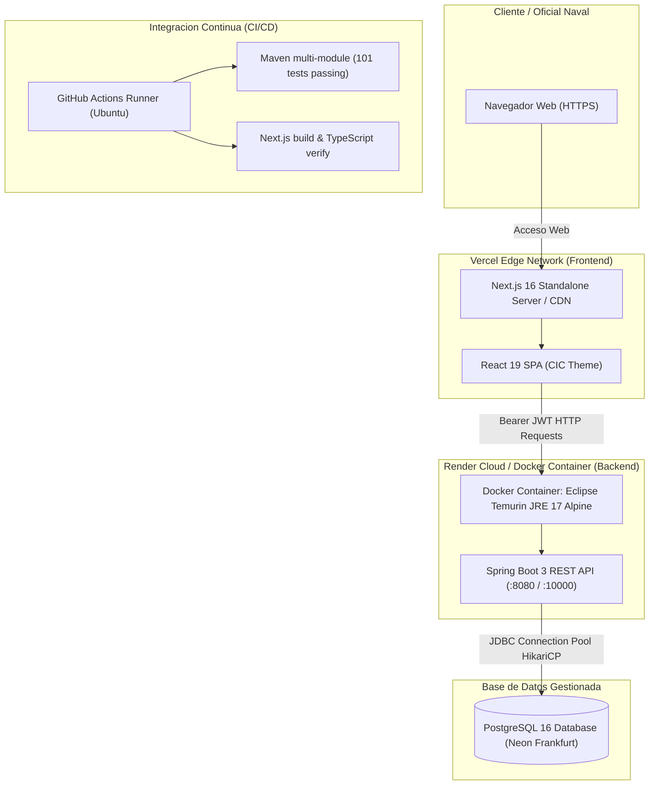

# Arquitectura y Diseño Tecnico - Battleship Platform

Este documento actualiza y consolida las especificaciones tecnicas de arquitectura, modelado del dominio y patrones de diseno aplicados en la plataforma, sustituyendo los diagramas estaticos previos mediante especificaciones en formato Mermaid.

---

## 1. Diagrama de Componentes (Clean Architecture)

El sistema estructura sus responsabilidades siguiendo principios de Clean Architecture y separacion de incumbencias.



---

## 2. Diagrama de Clases del Dominio

Representacion de la jerarquia de naves, participantes y contratos del dominio.



---

## 3. Maquina de Estados de Partida e Impactos



---

## 4. Estrategias Algoritmicas de Inteligencia Artificial



---

## 5. Arquitectura Backend Enterprise (Spring Boot 3 & REST API)

El modulo `battleship-backend` implementa una arquitectura desacoplada basada en capas de servicios, repositorios reactivos/JPA y seguridad sin estado (stateless) mediante JWT.



---

## 6. Modelo Entidad-Relacion (Spring Data JPA)



---

## 7. Catalogo de Endpoints REST (OpenAPI 3 / Swagger)

| Metodo | Ruta | Descripcion | Autenticacion |
| :--- | :--- | :--- | :--- |
| `POST` | `/api/v1/auth/register` | Registro de nuevo oficial y despacho de codigo OTP | Publico |
| `POST` | `/api/v1/auth/verify-email` | Validacion de codigo PIN militar de 6 digitos | Publico |
| `POST` | `/api/v1/auth/resend-code` | Reenvio de nuevo codigo OTP a la bandeja de entrada | Publico |
| `POST` | `/api/v1/auth/login` | Inicio de sesion y obtencion de Bearer JWT | Publico |
| `GET` | `/api/v1/auth/me` | Consulta de perfil del usuario en sesion | Bearer JWT |
| `PUT` | `/api/v1/auth/password` | Cambio seguro de credencial de acceso | Bearer JWT |
| `POST` | `/api/v1/games` | Creacion de partida vs IA (EASY, NORMAL, HARD) | Libre / Invitado |
| `GET` | `/api/v1/games/{gameId}` | Estado de partida con niebla de guerra para el rival | Libre / Invitado |
| `POST` | `/api/v1/games/{gameId}/shots` | Disparo tactico y contraataque reactivo de IA | Libre / Invitado |
| `POST` | `/api/v1/games/{gameId}/claim` | Reclamacion y persistencia de partida jugada como invitado | Bearer JWT |
| `GET` | `/api/v1/games/{gameId}/history` | Trazabilidad completa de disparos de la partida | Bearer JWT |
| `GET` | `/api/v1/leaderboard/matches` | Top 10 mejores partidas individuales (victorias/derrotas) | Publico |
| `GET` | `/api/v1/leaderboard/players` | Top 10 mejores oficiales ordenados por suma de puntos | Publico |
| `GET` | `/api/v1/leaderboard/me/matches` | Top 10 mejores partidas personales del oficial en sesion | Bearer JWT |
| `GET` | `/api/v1/leaderboard/me/recent` | Historial cronologico de ultimas 10 batallas | Bearer JWT |
| `GET` | `/api/v1/leaderboard/me/stats` | Estadisticas de carrera militar y rango naval | Bearer JWT |
| `GET` | `/healthz` | Endpoint de salud y disponibilidad para orquestadores cloud | Publico |
| `GET` | `/swagger-ui.html` | Interfaz interactiva de documentacion OpenAPI 3 | Publico |
| `GET` | `/v3/api-docs` | Especificacion JSON OpenAPI 3.0 viva | Publico |
| `GET` | `/h2-console` | Consola web de administracion de base de datos H2 | Publico (Dev) |

---

## 8. Arquitectura Frontend Web (Next.js 16, React 19, Tailwind CSS)

El modulo `frontend/` implementa una interfaz de usuario reactiva, responsive y de estetica militar retro CRT ("Combat Information Center"), conectada directamente con la API REST del backend mediante JWT o en Modo Invitado efimero.



---

## 9. Topologia y Arquitectura de Despliegue DevOps (Docker & Cloud)

La plataforma esta preparada tanto para orquestacion multi-contenedor local mediante Docker Compose como para despliegue distribuido de alto rendimiento en la nube (Vercel + Render + PostgreSQL en Neon).


```
